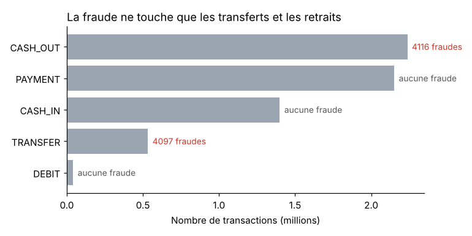
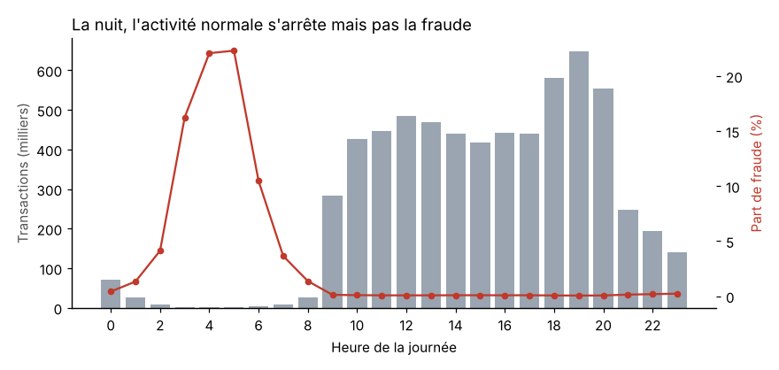
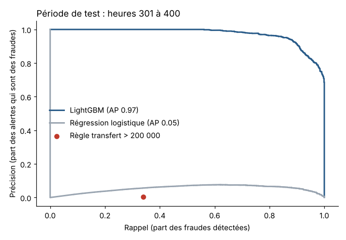
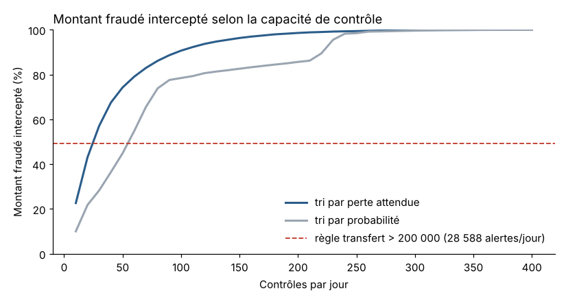

# Détection de fraude sur des transactions mobile money

Projet personnel réalisé dans le cadre de mon MBA Data & IA (ISM Dakar). Je voulais travailler sur un sujet proche de ce que vivent les banques et les opérateurs de mobile money en Afrique de l'Ouest : comment repérer les transactions frauduleuses quand on ne peut pas tout contrôler.

## Les données

J'ai utilisé PaySim, un jeu de données disponible sur Kaggle ([lien](https://www.kaggle.com/datasets/ealaxi/paysim1)). Il est généré par un simulateur construit à partir d'un mois de transactions réelles d'un service de mobile money dans un pays africain. On y trouve 6,3 millions de transactions sur 31 jours, dont 8 213 fraudes (0,13 %).

Le fichier fait 493 Mo, il n'est donc pas dans le repo. Pour relancer le notebook il faut le télécharger et le placer dans `data/paysim.csv`.

## Ce que montrent les données

La fraude ne concerne que deux types d'opérations, les transferts et les retraits (CASH_OUT). Il n'y en a aucune dans les paiements, les dépôts ou les débits.



Le scénario est presque toujours le même : le fraudeur transfère tout le solde du compte, puis le retire. 97,7 % des fraudes vident un compte qui n'était pas vide, contre 42,7 % des opérations normales du même type. Le montant médian d'une fraude est aussi 2,6 fois plus élevé.

L'heure joue beaucoup. Entre 0h et 7h il n'y a que 2 % des transactions, mais un tiers des fraudes. Les fraudeurs ne s'arrêtent pas la nuit, les clients normaux oui.



## La règle existante ne suffit pas

Le dataset contient une règle déjà en place qui bloque les gros transferts (plus de 200 000). Sur tout le mois, elle n'a bloqué que 16 fraudes sur 8 213.

J'ai aussi testé une version plus large de cette règle, qui signale tous les transferts de plus de 200 000. Elle attrape 34 % des fraudes, mais elle produit environ 28 600 alertes par jour pour 258 fraudes. Aucune équipe ne peut traiter ça.

## Le modèle

J'ai découpé les données dans le temps plutôt qu'au hasard : apprentissage sur les heures 1 à 250, validation sur 251 à 300, test sur 301 à 400. C'est plus proche de la réalité, où on entraîne sur le passé pour prédire la suite. Je n'ai pas gardé la fin de la simulation (après l'heure 400) parce que le simulateur y produit très peu de transactions normales et le taux de fraude devient irréaliste.

Mon premier modèle, avec toutes les colonnes, avait un score quasi parfait. En regardant les variables les plus utilisées, j'ai vu qu'il s'appuyait sur les soldes après transaction, qui dans PaySim ne sont pas calculés de la même façon pour les fraudes. Le modèle apprenait un défaut du simulateur. J'ai donc gardé uniquement les informations connues au moment où le client lance l'opération : montant, type, heure, solde avant l'opération et part du solde envoyée.

Avec ces variables, LightGBM obtient une précision moyenne (AP) de 0,97 sur la période de test. Une régression logistique ne dépasse pas 0,05, parce que la fraude dépend de combinaisons (vider le compte, la nuit, sur un transfert) qu'un modèle linéaire capte mal.



## Combien de contrôles par jour ?

C'est la partie qui m'intéressait le plus. J'ai simulé une équipe antifraude qui contrôle un nombre fixe de transactions par jour, en commençant par celles qui ont le score le plus élevé. J'ai comparé deux façons de trier : par probabilité de fraude, et par perte attendue (probabilité multipliée par le montant).

| Contrôles par jour | Montant fraudé intercepté, tri par probabilité | Montant fraudé intercepté, tri par perte attendue |
|---|---|---|
| 25 | 26 % | 51 % |
| 50 | 45 % | 74 % |
| 100 | 78 % | 91 % |
| 200 | 86 % | 99 % |

Avec 100 contrôles par jour et un tri par perte attendue, on intercepte 91 % du montant fraudé. Le simple fait de trier par perte attendue plutôt que par probabilité fait gagner autant que changer de modèle.



## Limites

Ce sont des données simulées. Les fraudeurs de PaySim suivent tous le même scénario, ce qui explique des scores aussi élevés. Sur des données réelles, les résultats seraient nettement plus bas et le modèle devrait être réentraîné régulièrement, parce que les fraudeurs changent de méthode.

Pour aller plus loin il faudrait ajouter l'historique de chaque client (montants et fréquence habituels, nouveau bénéficiaire, premier transfert de nuit), et mesurer le coût réel d'un contrôle pour fixer le bon nombre d'alertes.

## Application web

J'ai aussi mis le modèle dans une petite application Streamlit. Elle permet de tester une transaction et d'obtenir son score, de faire varier le nombre de contrôles par jour pour voir le montant intercepté, et de charger un fichier CSV pour obtenir la liste des opérations à contrôler en priorité.

L'application n'a pas besoin du gros fichier de données. Elle utilise seulement le modèle déjà entraîné et quelques fichiers de résultats, qui sont dans `modele/`. Ces fichiers sont produits par `scripts/exporter_modele.py`.

Pour la lancer en local :

```
pip install -r requirements.txt
streamlit run app.py
```

Pour la déployer sur Render, le fichier `render.yaml` contient la configuration. Il suffit de créer un nouveau Blueprint à partir de ce repo, ou un Web Service avec la commande de démarrage suivante :

```
streamlit run app.py --server.port $PORT --server.address 0.0.0.0 --server.headless true
```

## Contenu du repo

- `detection_fraude_mobile_money.ipynb` : le notebook complet, de l'exploration au modèle
- `app.py` : l'application Streamlit
- `fraude/features.py` : le calcul des variables, partagé entre l'entraînement et l'application
- `scripts/exporter_modele.py` : entraîne le modèle final et exporte les fichiers utilisés par l'application
- `modele/` : le modèle entraîné et les résultats précalculés
- `exemples/transactions_exemple.csv` : 1 000 transactions de la période de test pour essayer l'application
- `figures/` : les graphiques utilisés dans ce README

Outils : Python, pandas, scikit-learn, LightGBM, matplotlib, Streamlit. Pour ouvrir le notebook il faut aussi installer Jupyter.

Matar Ndoye Keita
